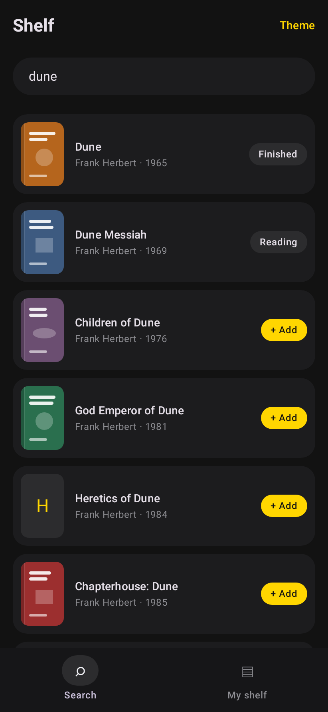
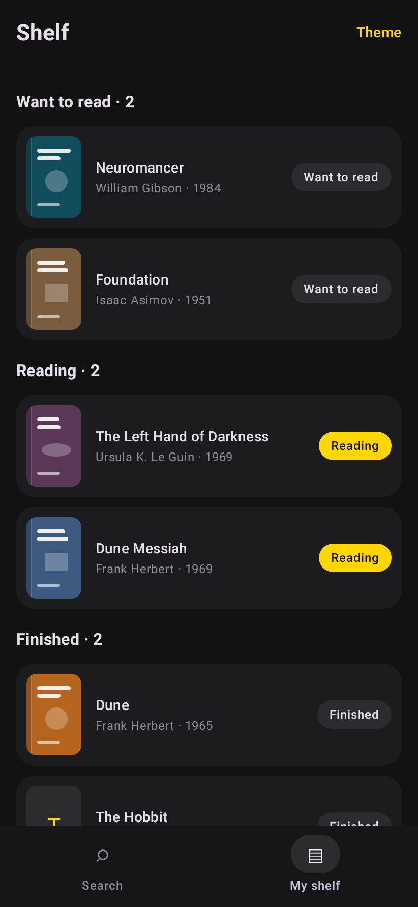
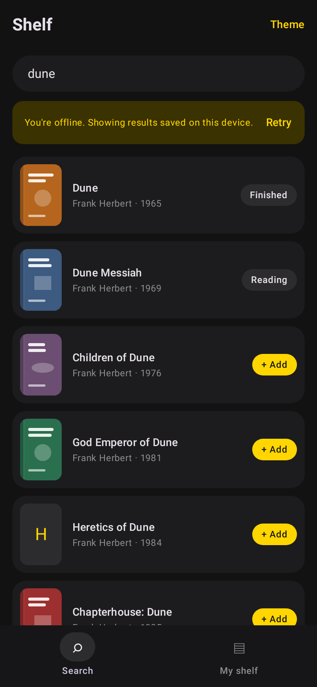
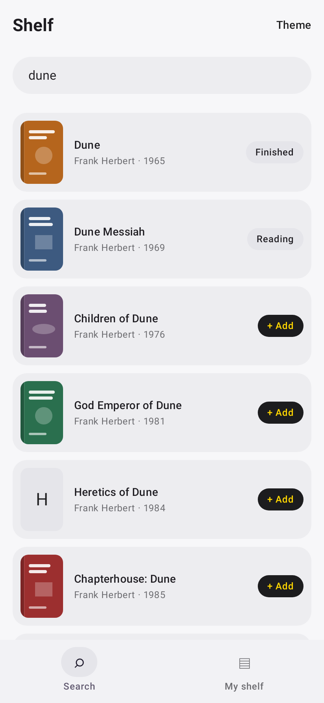
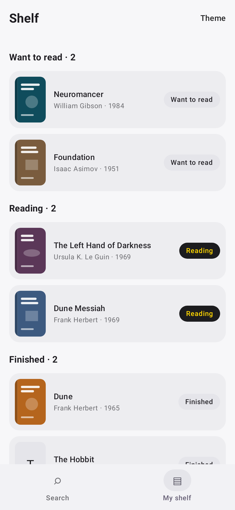
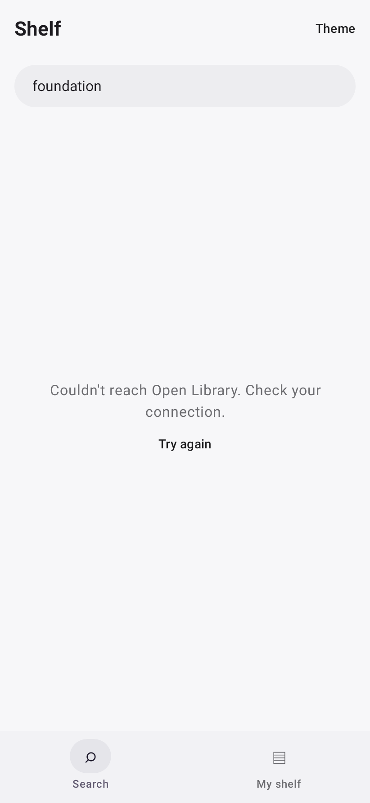
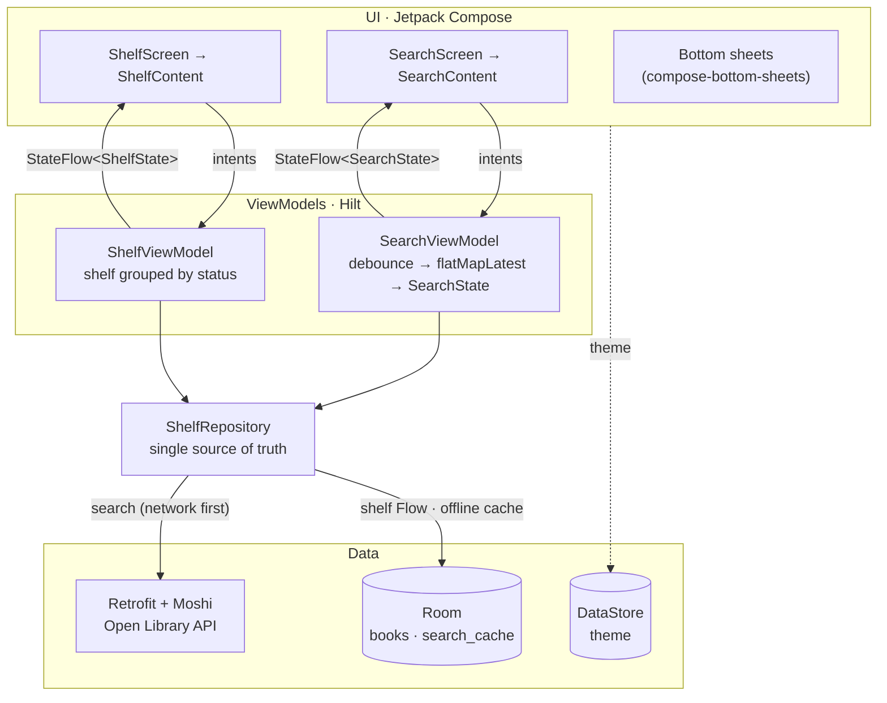

# Shelf — a modern Android reference app

[](https://github.com/ThalzeronLabs/compose-showcase/actions/workflows/ci.yml)
[](https://github.com/ThalzeronLabs/compose-showcase/releases/latest)
[](LICENSE)

**A small, complete reading-list app built the way production Android apps should be built in 2026:**
Jetpack Compose, MVVM with a single source of truth, Hilt, Room, Retrofit + Moshi, Coil, Navigation, DataStore,
an offline cache, tests at every layer (including Room migrations and screenshots) and CI that ships a signed APK.

Search millions of books (the public [Open Library](https://openlibrary.org/developers/api) API, no key needed), add
them to your shelf, and move them between *Want to read*, *Reading* and *Finished*. Searches you have made before
still work offline.

| Search | My shelf | Offline |
|:---:|:---:|:---:|
|  |  |  |

<details>
<summary>Light theme and error state</summary>

| Search | My shelf | No connection, nothing cached |
|:---:|:---:|:---:|
|  |  |  |

</details>

These images are not mock-ups: they are rendered from the real composables by the
[screenshot tests](app/src/test/kotlin/com/thalzeronlabs/shelf/screenshots/ScreenshotTest.kt) on the JVM, and CI fails
if the UI drifts from them. (The book covers are generated placeholders, so no cover art lives in the repository.)

**Try it:** download the APK from the [latest release](https://github.com/ThalzeronLabs/compose-showcase/releases/latest)
(Android 8.0+).

## Architecture



Data flows down as immutable state and events flow up as plain function calls. Each screen is split into a thin
`…Screen` that talks to its ViewModel and a stateless `…Content` that only renders state, which is what previews and
screenshot tests use.

**Decisions worth noting**

- **Search is reactive, not imperative.** The query is a `StateFlow`; `debounce(400 ms)` + `distinctUntilChanged` +
  `flatMapLatest` cancel stale requests automatically. A retry counter re-runs the same query without hacks.
- **Results know what is already on the shelf** by `combine`-ing the network result with the Room flow, so the badge
  updates the instant a book is saved, with no manual refresh.
- **Offline is a state, not an error.** Every successful search replaces the cached rows for that query in one Room
  transaction. When the network fails (`IOException` or an HTTP error), the repository returns the cached results with
  the time they were saved, and the UI shows them under an "offline" banner. Only with nothing cached does the user
  see the error state.
- **Loading, empty, error and offline are distinct states**, each with its own UI, instead of one `isLoading` boolean.
- **Questions use awaitable bottom sheets** (`sheets.choose(...)`, `sheets.confirm(...)`) from my
  [compose-bottom-sheets](https://github.com/ThalzeronLabs/compose-bottom-sheets) library, so a two-step flow
  (pick an action → confirm removal) reads as two lines of sequential code.
- **Schema changes are migrations, never wipes.** The Room schema is exported to [`app/schemas`](app/schemas); version 2
  adds the cache table with an `AutoMigration`, and a test proves a version-1 shelf survives the upgrade.
- **Release builds are minified with R8** and still work: Moshi uses generated adapters, Room and Hilt use KSP, so
  there is no reflection for R8 to break and no keep rules to maintain.

## Why these choices

| Library | Why it is here |
|---|---|
| **Jetpack Compose + Material 3** | Declarative UI that renders straight from state; no XML, no view binding, and screens can be tested and screenshotted as plain functions. |
| **Kotlin coroutines + Flow** | One model for async work and streams. `StateFlow` is the contract between ViewModels and the UI; operators like `debounce` and `flatMapLatest` replace hand-written timers and cancellation. |
| **Hilt** | Compile-time dependency injection with the least ceremony on Android; ViewModels get their repository through `@Inject` and `hiltViewModel()`. Wiring errors fail the build instead of the app. |
| **Room** | Type-safe SQLite with `Flow` queries, so the shelf updates itself. Exported schemas make migrations reviewable and testable. KSP, not reflection, so it survives R8. |
| **Retrofit 3 + Moshi codegen** | The standard HTTP client for Kotlin, with suspend functions. Moshi's generated adapters are fast, explicit about nullability and need no R8 keep rules, unlike reflection-based JSON. |
| **OkHttp** | The HTTP engine under Retrofit (timeouts set in `AppModule`) and under Coil (`coil-network-okhttp`). |
| **Coil 3** | Kotlin-first image loading built on coroutines, with memory and disk caching. Its preview handler lets the screenshot tests draw covers without network. |
| **Navigation Compose** | Back stack and per-tab state (`saveState`/`restoreState`) for the bottom navigation without custom code. |
| **DataStore (Preferences)** | The asynchronous, `Flow`-based replacement for `SharedPreferences`; used for the theme. |
| **compose-bottom-sheets** | My small library that turns a bottom sheet into a `suspend` function returning the user's choice. Pulled in as a git submodule. |
| **JUnit 4 + kotlinx-coroutines-test + Turbine** | Virtual time for debounce and latency, and readable assertions on every emission of a `Flow`. |
| **Robolectric** | Runs real Android code (Room's SQLite, Compose rendering) on the JVM, so no test needs an emulator. |
| **Roborazzi** | Screenshot testing on top of Robolectric: records images to `docs/screenshots` and verifies them in CI. |
| **room-testing** | `MigrationTestHelper` builds a database from an old exported schema and validates the migrated one. |

## Tests

```bash
./gradlew :app:verifyRoborazziDebug   # everything below, as CI runs it
./gradlew :app:testDebugUnitTest      # the same tests without the image comparison
./gradlew :app:recordRoborazziDebug   # re-record the screenshots after a deliberate UI change
```

27 tests, all on the JVM; no emulator or device is needed.

| Suite | Runs on | What it proves |
|---|---|---|
| [`ViewModelsTest`](app/src/test/kotlin/com/thalzeronlabs/shelf/ViewModelsTest.kt) (9) | JVM, Turbine | Debounce collapses typing into one request; short queries never hit the network; a new query cancels the one in flight; empty vs error states; retry; offline results keep their timestamp and shelf badges; queries are trimmed; shelf grouping, moving and removing |
| [`ShelfRepositoryTest`](app/src/test/kotlin/com/thalzeronlabs/shelf/ShelfRepositoryTest.kt) (3) | JVM, fakes | API → domain mapping (trimming, missing fields, cover URLs), shelf ordering, status changes |
| [`OfflineSearchCacheTest`](app/src/test/kotlin/com/thalzeronlabs/shelf/data/OfflineSearchCacheTest.kt) (7) | Robolectric, real in-memory Room | Results are cached in order; offline (no connection or HTTP error) they come back with when they were saved; the cache key ignores case and spaces; new results replace old ones with no stale rows; with nothing cached the original error is rethrown |
| [`ShelfMigrationTest`](app/src/test/kotlin/com/thalzeronlabs/shelf/data/ShelfMigrationTest.kt) (2) | Robolectric, `MigrationTestHelper` | A version-1 database with books migrates to version 2 with every book intact and the schema matching `2.json`; the app's real database builder opens a version-1 file |
| [`ScreenshotTest`](app/src/test/kotlin/com/thalzeronlabs/shelf/screenshots/ScreenshotTest.kt) (6) | Robolectric + Roborazzi | Search, shelf, offline and error screens in dark and light themes match `docs/screenshots` |

Not covered yet: the Compose interaction flows (tapping through the bottom sheets) and `SettingsStore`.

## APK size

The release APK is minified and resource-shrunk with R8. Measured locally on 2026-11-01 from the v1.0.0 source, signed
with the debug key (same machine, only `isMinifyEnabled`/`isShrinkResources` changed between the two builds):

| Release APK | Size |
|---|---|
| With R8 (what ships) | **1,880,561 bytes (1.79 MiB)** |
| Without R8 | 10,355,516 bytes (9.88 MiB) |

R8 removes about 82% of the APK. `apkanalyzer` estimates the compressed download at 1,619,217 bytes. Every CI run
prints the current size in its job summary, and each GitHub release lists the size and SHA-256 of its APK.

Measure it yourself:

```bash
./gradlew :app:assembleRelease
ls -l app/build/outputs/apk/release/app-release.apk
$ANDROID_HOME/cmdline-tools/latest/bin/apkanalyzer apk download-size app/build/outputs/apk/release/app-release.apk
```

Or open the APK with **Build → Analyze APK…** in Android Studio to see what each library contributes.

## Build

```bash
git clone --recursive https://github.com/ThalzeronLabs/compose-showcase
cd compose-showcase
./gradlew :app:installDebug
```

Requires JDK 17+ and the Android SDK. Local release builds are signed with the debug key so they install anywhere.

## Releases

Pushing a `vX.Y.Z` tag runs the [release workflow](.github/workflows/release.yml): it runs the tests, builds the R8
APK, signs it with a **demo key generated inside that workflow run** (never stored, different for every release, not
a Play Store key), verifies the signature and attaches the APK to the GitHub release with its size and checksums.
See [`CHANGELOG.md`](CHANGELOG.md) for what changed.

## Contributing

Issues labelled [`good first issue`](https://github.com/ThalzeronLabs/compose-showcase/labels/good%20first%20issue)
are a good place to start. [`CONTRIBUTING.md`](CONTRIBUTING.md) explains the setup, the tests and how screenshots
are updated.

## License

Apache-2.0 © Esdras Souza (Thalzeron Labs). Book data © Open Library contributors.
