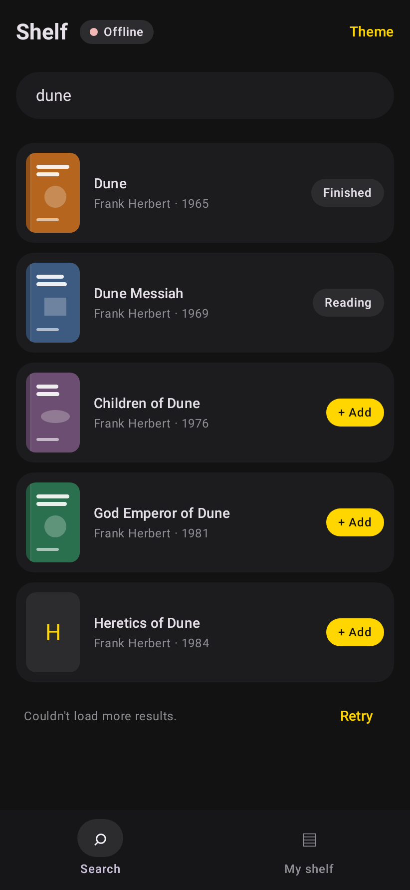
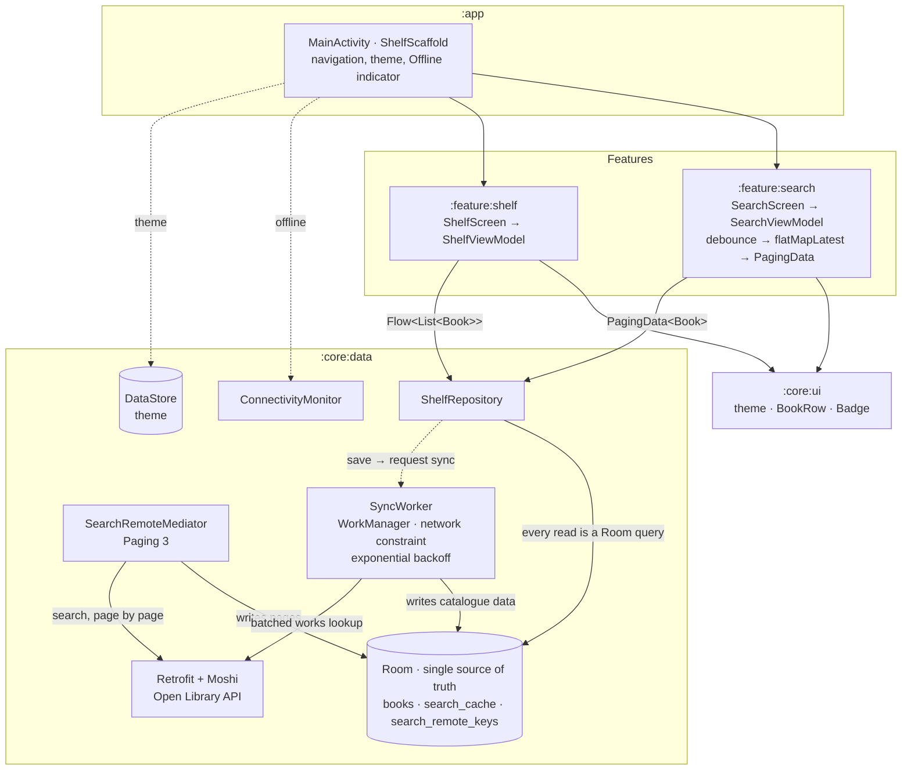

# Shelf — a modern Android reference app

[](https://github.com/ThalzeronLabs/compose-showcase/actions/workflows/ci.yml)
[](https://github.com/ThalzeronLabs/compose-showcase/releases/latest)
[](LICENSE)

**A small, complete reading-list app built the way production Android apps should be built in 2026:**
Jetpack Compose, MVVM, offline-first with Room as the single source of truth, Paging 3 with a `RemoteMediator`,
background sync with WorkManager, Hilt, Retrofit + Moshi, Coil, Navigation, DataStore, a modular build, Baseline
Profiles with Macrobenchmark, tests at every layer (including Room migrations, WorkManager and screenshots) and CI
that ships a signed APK.

Search millions of books (the public [Open Library](https://openlibrary.org/developers/api) API, no key needed), add
them to your shelf, and move them between *Want to read*, *Reading* and *Finished*. Results you have loaded before
are still there offline, the list pages in more as you scroll, and the shelf keeps itself up to date with the
catalogue in the background.

| Search | My shelf | Offline |
|:---:|:---:|:---:|
|  |  |  |

<details>
<summary>Light theme, error states and a connection that drops while paging</summary>

| Search | My shelf | No connection, nothing cached | Next page failed |
|:---:|:---:|:---:|:---:|
|  |  |  |  |

</details>

These images are not mock-ups: they are rendered from the real composables by the
[screenshot tests](app/src/test/kotlin/com/thalzeronlabs/shelf/screenshots/ScreenshotTest.kt) on the JVM, and CI fails
if the UI drifts from them. (The book covers are generated placeholders, so no cover art lives in the repository.)

**Try it:** download the APK from the [latest release](https://github.com/ThalzeronLabs/compose-showcase/releases/latest)
(Android 8.0+).

## Architecture



The UI never reads the network. Every screen observes a Room query; the network only ever *writes into* Room, through
the `RemoteMediator` (search pages) or the `SyncWorker` (shelf books). That one rule is what makes the app work offline
without special cases: offline, the same queries simply return what is already on the device.

Data flows down as immutable state and events flow up as plain function calls. Each screen is split into a thin
`…Screen` that talks to its ViewModel and a stateless `…Content` that only renders state, which is what previews and
screenshot tests use.

### Modules

| Module | What lives there | Depends on |
|---|---|---|
| `:app` | `MainActivity`, navigation, the scaffold with the Offline indicator, Hilt and WorkManager setup | everything below |
| `:feature:search` | Search screen, `SearchViewModel`, how Paging's load states become screen states | `:core:data`, `:core:ui` |
| `:feature:shelf` | Shelf screen, `ShelfViewModel` | `:core:data`, `:core:ui` |
| `:core:data` | Model, Room, Retrofit, the `RemoteMediator`, the sync, connectivity, settings, DI | — |
| `:core:ui` | Theme and shared composables; knows nothing about data | — |
| `:core:testing` | `FakeShelfRepository` and sample data for the features' tests | `:core:data` |
| `:benchmark` | Baseline Profile generator and start-up benchmark (device only) | `:app` (as target) |

Features never depend on each other, and `:core:ui` takes plain values (`BookRow(title, byline, coverUrl)`), not data
classes, so the design system can change without touching the data layer and vice versa.

**Decisions worth noting**

- **Room is the single source of truth.** Search results are rows in `search_cache`; the list pages through them with
  a Room `PagingSource`. A shelf badge on a result is a `LEFT JOIN` with `books`, so saving a book updates its row
  because Room invalidates the query, not because some code remembers to refresh it.
- **The `RemoteMediator` writes each page and its next offset in one transaction.** A connection that drops between
  pages loses nothing: the loaded rows stay, the saved offset still points at the missing page, and "Retry" asks for
  exactly that page again. A refresh swaps the old rows for the new ones in one transaction too, so a refresh that
  fails leaves the cached results untouched, and a result Open Library repeats on a later page is kept once.
- **Offline is a state, not an error.** Cached rows always show. If the refresh fails, a banner says the results are
  the ones saved on this device; only with nothing cached does the user see the error state. A small *Offline*
  indicator in the top bar follows the device's default network.
- **The sync never overwrites the user's data.** `SyncWorker` refreshes only the catalogue fields (title, authors, year,
  cover) with an `UPDATE`, never an upsert: a status changed while the sync is in flight is kept, and a book removed
  meanwhile does not come back. Books go in batches of 20, one request each, every batch committed on its own and
  stamped `syncedAt`, so a sync cut off halfway resumes with only the books still stale.
- **WorkManager decides when.** A one-off sync after every save and a periodic one every 12 hours, both only with a
  network (`NetworkType.CONNECTED`) and with exponential backoff from 30 s. I/O errors, 5xx and 429 are retried, other
  4xx are not; after six attempts the periodic sync tries again later. Workers get their dependencies through
  `HiltWorkerFactory`.
- **Search is reactive, not imperative.** The query is a `StateFlow`; `debounce(400 ms)` + `distinctUntilChanged` +
  `flatMapLatest` drop stale pagers (and their requests) automatically, and `cachedIn` keeps loaded pages across
  configuration changes.
- **Loading, empty, error, saved results and "couldn't load more" are distinct states**, each with its own UI, worked
  out by one pure function (`searchStatus`) from Paging's two load states: Room's and the network's.
- **Questions use awaitable bottom sheets** (`sheets.choose(...)`, `sheets.confirm(...)`) from my
  [compose-bottom-sheets](https://github.com/ThalzeronLabs/compose-bottom-sheets) library, so a two-step flow
  (pick an action → confirm removal) reads as two lines of sequential code.
- **Schema changes are migrations, never wipes.** The Room schema is exported to
  [`core/data/schemas`](core/data/schemas). Version 2 added the search cache and version 3 the paging keys and the
  sync stamp, both with `AutoMigration`; tests prove a version-1 shelf survives the upgrade to 3.
- **Release builds are minified with R8** and still work: Moshi uses generated adapters, Room and Hilt use KSP, so
  there is no reflection for R8 to break and no keep rules to maintain.

## Why these choices

| Library | Why it is here |
|---|---|
| **Jetpack Compose + Material 3** | Declarative UI that renders straight from state; no XML, no view binding, and screens can be tested and screenshotted as plain functions. |
| **Kotlin coroutines + Flow** | One model for async work and streams. `StateFlow` is the contract between ViewModels and the UI; operators like `debounce` and `flatMapLatest` replace hand-written timers and cancellation. |
| **Hilt** | Compile-time dependency injection with the least ceremony on Android; ViewModels get their repository through `@Inject` and `hiltViewModel()`. Wiring errors fail the build instead of the app. |
| **Room** | Type-safe SQLite with `Flow` and `PagingSource` queries that re-run when their tables change, which is what makes it a usable single source of truth. Exported schemas make migrations reviewable and testable. KSP, not reflection, so it survives R8. |
| **Paging 3 + `RemoteMediator`** | The standard way to page a network list through a local database: Room serves the pages, the mediator fills Room, and the load states for both come for free, including retry. Rolling this by hand means re-solving prefetching, cancellation and invalidation. |
| **WorkManager + `hilt-work`** | Deferrable background work that survives process death and reboots, with constraints (only on a network) and backoff built in. The right tool for "sync when you can", unlike a coroutine that dies with the screen. |
| **Retrofit 3 + Moshi codegen** | The standard HTTP client for Kotlin, with suspend functions. Moshi's generated adapters are fast, explicit about nullability and need no R8 keep rules, unlike reflection-based JSON. |
| **OkHttp** | The HTTP engine under Retrofit (timeouts set in `DataModule`) and under Coil (`coil-network-okhttp`). |
| **Coil 3** | Kotlin-first image loading built on coroutines, with memory and disk caching. Its preview handler lets the screenshot tests draw covers without network. |
| **Navigation Compose** | Back stack and per-tab state (`saveState`/`restoreState`) for the bottom navigation without custom code. |
| **DataStore (Preferences)** | The asynchronous, `Flow`-based replacement for `SharedPreferences`; used for the theme. |
| **Baseline Profiles + `profileinstaller`** | Ships a list of the classes and methods used at start-up and in the main journey so they are compiled ahead of time on install, instead of interpreted and JIT-compiled on first use. `profileinstaller` installs it for APKs that do not come from Play, like the one in Releases. |
| **Macrobenchmark + UiAutomator** | Measures the real release app from the outside (cold start, frames) and drives the journey the Baseline Profile is generated from. |
| **compose-bottom-sheets** | My small library that turns a bottom sheet into a `suspend` function returning the user's choice. Pulled in as a git submodule. |
| **JUnit 4 + kotlinx-coroutines-test + Turbine** | Virtual time for debounce, and readable assertions on every emission of a `Flow`. |
| **paging-testing** | `asSnapshot` turns a `Flow<PagingData>` into a plain list (scrolling included) so the whole Paging + Room + mediator stack is tested without a UI. |
| **work-testing** | Runs workers directly with chosen attempt counts, and a test WorkManager whose constraints the test can switch on, so retry and scheduling logic is tested on the JVM. |
| **Robolectric** | Runs real Android code (Room's SQLite, WorkManager, `ConnectivityManager`, Compose rendering) on the JVM, so no test needs an emulator. |
| **Roborazzi** | Screenshot testing on top of Robolectric: records images to `docs/screenshots` and verifies them in CI. |
| **room-testing** | `MigrationTestHelper` builds a database from an old exported schema and validates the migrated one. |

## Tests

```bash
./gradlew testDebugUnitTest -Proborazzi.test.verify=true   # every module, plus the screenshot comparison (what CI runs)
./gradlew testDebugUnitTest                                # the same tests without the image comparison
./gradlew :app:recordRoborazziDebug                        # re-record the screenshots after a deliberate UI change
```

63 tests, all on the JVM; no emulator or device is needed.

| Suite | Runs on | What it proves |
|---|---|---|
| [`SearchRemoteMediatorTest`](core/data/src/test/kotlin/com/thalzeronlabs/shelf/data/SearchRemoteMediatorTest.kt) (10) | Robolectric, real in-memory Room | Pages are stored in order with the next offset; appending stops at the end; **a connection that drops between pages keeps the loaded rows and resumes at the same page with no gap or duplicate**; a failed refresh leaves the cache untouched; HTTP errors are errors, not empty results; a refresh replaces stale rows; repeated books are kept once; untitled documents still count towards the offset; the cache key ignores case and spaces |
| [`ShelfRepositoryTest`](core/data/src/test/kotlin/com/thalzeronlabs/shelf/data/ShelfRepositoryTest.kt) (7) | Robolectric, Paging + Room + mediator | Scrolling pages more in from the network; shelf badges come through the Room join; offline, a query searched before still shows its rows while one never searched shows the error; shelf order, status changes and removals; saving asks for a sync |
| [`ShelfSyncerTest`](core/data/src/test/kotlin/com/thalzeronlabs/shelf/data/sync/ShelfSyncerTest.kt) (6) | Robolectric, real in-memory Room | Fresh catalogue data keeps the user's status; recently synced books are skipped; **a sync cut off halfway keeps the finished batches and the retry does only the rest**; a status change or a removal during the sync survives; data Open Library no longer returns is kept |
| [`SyncWorkerTest`](core/data/src/test/kotlin/com/thalzeronlabs/shelf/data/sync/SyncWorkerTest.kt) (7) | Robolectric, work-testing | Success, retry on I/O, 5xx and 429, failure on other 4xx and after the last attempt; both requests need a network and back off exponentially; a requested sync waits for the network, then runs; unique work is not duplicated |
| [`ConnectivityMonitorTest`](core/data/src/test/kotlin/com/thalzeronlabs/shelf/data/ConnectivityMonitorTest.kt) (2) | Robolectric | The offline flow starts with the current state, follows the default network (a network without internet counts as offline), drops repeats and unregisters when nobody listens |
| [`ShelfMigrationTest`](core/data/src/test/kotlin/com/thalzeronlabs/shelf/data/ShelfMigrationTest.kt) (3) | Robolectric, `MigrationTestHelper` | 1 → 2 and 2 → 3 keep every row and match the exported schemas; the app's real database builder opens a version-1 file |
| [`DocMappingTest`](core/data/src/test/kotlin/com/thalzeronlabs/shelf/data/DocMappingTest.kt) (3) | JVM | API → domain mapping (trimming, missing fields, cover URLs) and the batched works query |
| [`SearchViewModelTest`](feature/search/src/test/kotlin/com/thalzeronlabs/shelf/feature/search/SearchViewModelTest.kt) (7) | JVM, Turbine, paging-testing | Debounce collapses typing into one search; short queries never search; queries are trimmed; a new query cancels the previous pager; results and clearing; saving |
| [`SearchStatusTest`](feature/search/src/test/kotlin/com/thalzeronlabs/shelf/feature/search/SearchStatusTest.kt) (8) | JVM | How Room's and the network's load states become idle, loading, empty, error, results, "refreshing" and "saved on this device" |
| [`ShelfViewModelTest`](feature/shelf/src/test/kotlin/com/thalzeronlabs/shelf/feature/shelf/ShelfViewModelTest.kt) (2) | JVM, Turbine | Shelf grouping, moving and removing |
| [`OfflineIndicatorTest`](app/src/test/kotlin/com/thalzeronlabs/shelf/OfflineIndicatorTest.kt) (1) | Robolectric, Compose UI test | The Offline indicator appears and disappears with connectivity |
| [`ScreenshotTest`](app/src/test/kotlin/com/thalzeronlabs/shelf/screenshots/ScreenshotTest.kt) (7) | Robolectric + Roborazzi | Search, shelf, offline, error and "couldn't load more" screens in dark and light themes match `docs/screenshots` |

Not covered yet: the Compose interaction flows (tapping through the bottom sheets) and `SettingsStore`.

## Performance

The release APK carries a **Baseline Profile** in `assets/dexopt/baseline.prof`: the app's own (generated by
[`BaselineProfileGenerator`](benchmark/src/main/kotlin/com/thalzeronlabs/shelf/benchmark/BaselineProfileGenerator.kt) from
start-up and the main journey: search, scroll, open the shelf) merged with the profiles the libraries ship.
`profileinstaller` compiles it on install, also for the APK from Releases, which does not come through Play.

**Measuring cold start-up yourself.** [`StartupBenchmark`](benchmark/src/main/kotlin/com/thalzeronlabs/shelf/benchmark/StartupBenchmark.kt)
starts the release build cold 10 times in each mode, `CompilationMode.None()` (no profile) and
`CompilationMode.Partial(BaselineProfileMode.Require)` (with it), and reports `timeToInitialDisplayMs`, the time to the
first frame. On a physical device (Android 10+, USB debugging on, screen unlocked):

```bash
./gradlew :benchmark:connectedBenchmarkReleaseAndroidTest \
    -Pandroid.testInstrumentationRunnerArguments.androidx.benchmark.enabledRules=Macrobenchmark
```

The results are printed in the Gradle output and saved, per run, as JSON under
`benchmark/build/outputs/connected_android_test_additional_output/`. Close other apps, let the phone cool down and
compare medians, not single runs. To regenerate the profile after changing the start-up path or the main journey:

```bash
./gradlew :app:generateBaselineProfile   # runs on the Gradle-managed emulator defined in :benchmark
```

The [Baseline profile workflow](.github/workflows/baseline-profile.yml) runs both on a Pixel 6 (API 34) emulator on
GitHub Actions and writes the table to its job summary.

**What CI measured.** [This run](https://github.com/ThalzeronLabs/compose-showcase/actions/runs/41407100256)
(2026-11-02, "Android SDK built for x86_64" emulator, API 34, 10 cold starts per mode) produced the committed profile
and these `timeToInitialDisplayMs` values:

| Mode | Min | Median | Max |
|---|---:|---:|---:|
| Without the profile (`CompilationMode.None`) | 821.8 ms | 862.3 ms | 947.0 ms |
| With the profile (`Partial`, `BaselineProfileMode.Require`) | 750.9 ms | 889.9 ms | 1,238.9 ms |

On that emulator the two medians are within each other's spread, so this run shows **no measurable start-up gain**
and I do not claim one. A software-rendered x86_64 emulator on a shared CI machine is a poor stand-in for a phone; the
numbers that matter come from the command above on a real device, and none are published here until they have been
measured.

## APK size

The release APK is minified and resource-shrunk with R8. Measured locally on 2026-11-01 from the **v1.0.0** source, signed
with the debug key (same machine, only `isMinifyEnabled`/`isShrinkResources` changed between the two builds):

| Release APK | Size |
|---|---|
| With R8 (what ships) | **1,880,561 bytes (1.79 MiB)** |
| Without R8 | 10,355,516 bytes (9.88 MiB) |

R8 removes about 82% of the APK. `apkanalyzer` estimates the compressed download at 1,619,217 bytes. Every CI run
prints the current size in its job summary, and each GitHub release (1.1.0 included) lists the size and SHA-256 of
its APK.

Measure it yourself:

```bash
./gradlew :app:assembleRelease
ls -l app/build/outputs/apk/release/app-release.apk
$ANDROID_HOME/cmdline-tools/latest/bin/apkanalyzer apk download-size app/build/outputs/apk/release/app-release.apk
```

Or open the APK with **Build → Analyze APK…** in Android Studio to see what each library contributes.

## Build

```bash
git clone --recursive https://github.com/ThalzeronLabs/compose-showcase
cd compose-showcase
./gradlew :app:installDebug
```

Requires JDK 21 (Robolectric needs it for the Android 16 runtime used by the tests) and the Android SDK. Local release builds are signed with the debug key so they install anywhere.

## Releases

Pushing a `vX.Y.Z` tag runs the [release workflow](.github/workflows/release.yml): it runs the tests, builds the R8
APK from the tag's commit, signs it, checks that the APK carries the expected certificate and attaches it to the
GitHub release with its size, checksums and the commit it was built from.

Since 1.1.1 the APK is signed with a **fixed showcase demo key** kept in the repository's secrets, so each release
installs over the previous one. It is used only for these demo builds and is not a production or Play Store key.
Releases up to 1.1.0 were each signed with a one-off key, so uninstall one of those once before installing a newer
APK. Without the secrets (in a fork, for example) the workflow generates a one-off key for the run and throws it away.
See [`CHANGELOG.md`](CHANGELOG.md) for what changed.

## Contributing

Issues labelled [`good first issue`](https://github.com/ThalzeronLabs/compose-showcase/labels/good%20first%20issue)
are a good place to start. [`CONTRIBUTING.md`](CONTRIBUTING.md) explains the setup, the tests and how screenshots
are updated.

## License

Apache-2.0 © Esdras Souza (Thalzeron Labs). Book data © Open Library contributors.
